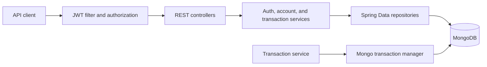

# Backend Ledger — Financial Account and Transaction REST API

## Overview

Backend Ledger is a REST API for user authentication, financial accounts, ledger-derived balances, and account-to-account transfers. It is built as a standalone Java service with Spring Boot, Spring Security, JWTs, MongoDB, and Maven.

The service keeps an append-only double-entry ledger. A transfer records a debit and a matching credit in one MongoDB transaction, while account ownership, idempotency, and concurrent balance checks are enforced on the server.

## Problem and objectives

Applications that move money need a consistent record of every credit and debit, a trustworthy way to calculate balances, and controls against unauthorized or repeated transfers. This project demonstrates those backend concerns with:

- Server-derived identity and account ownership.
- Immutable ledger entries and ledger-based balance calculation.
- Atomic transaction records and double-entry writes.
- Idempotent request handling and concurrent withdrawal protection.
- Explicit validation, error responses, and environment-based configuration.

## Features

- User registration and login with BCrypt password hashing.
- Signed, expiring JWT authentication through an HttpOnly cookie or a Bearer header.
- Current-user lookup and token blacklist checks on protected requests.
- Account creation, account listing, and owner-only balance lookup.
- Credit/debit ledger entries and atomic transfers.
- System-user-only initial funding with idempotent retries.
- Unique indexes for email and idempotency keys, plus a TTL index for revoked tokens.
- Unit, MVC, and MongoDB replica-set integration tests.

## Technology stack

- Java 21
- Spring Boot 3.4.5, Spring MVC, Spring Security, Spring Validation
- Spring Data MongoDB and MongoDB transactions
- JJWT 0.12.6
- Maven
- JUnit 5, Mockito, MockMvc, and a local MongoDB replica set for transaction integration tests

## Architecture

Controllers bind HTTP requests and return DTOs. Services enforce authentication-related and financial business rules. Repositories handle MongoDB access. Security filters validate credentials and establish the authenticated principal.



Main packages:

```text
com.ledger
├── account       account ownership and ledger-derived balances
├── auth          registration, login, and logout
├── config        JWT, MongoDB, and Spring Security configuration
├── controller    HTTP endpoints, DTOs, and error handling
├── model         MongoDB documents and enums
├── persistence   BSON double converters for BigDecimal fields
├── repository    MongoDB queries and append-only ledger insertion
├── security      JWT filtering and authenticated principal
└── transaction   transactional transfer and initial-funds operations
```

## Authentication and authorization

`POST /api/auth/register` and `POST /api/auth/login` issue a signed JWT in the `token` cookie. The cookie is HttpOnly, uses `SameSite=Lax`, and is Secure by default. The response JSON contains the user ID, email, and name; it does not contain the JWT, password, password hash, or system-user flag. Authentication responses use `Cache-Control: no-store`.

For protected requests, the security filter accepts the `token` cookie or `Authorization: Bearer <token>`. It validates the signature and expiration, checks that the token is not blacklisted, and reloads the user from MongoDB. System privileges come only from the stored user record. Public registration cannot set a user ID or grant the system-user role.

`POST /api/auth/logout` validates a supplied signed token before blacklisting it and clearing the cookie. Missing or malformed tokens do not create blacklist records. Revoked token records expire after 72 hours; the configurable JWT lifetime is therefore limited to one through three days.

There is no public endpoint for promoting a user to system-user status. Provision that role only through a trusted administrative process.

## Data model

| Collection | Main fields | Purpose |
| --- | --- | --- |
| `users` | `_id`, `email`, `name`, `password`, `systemUser`, timestamps | User identity; `password` stores a BCrypt hash and is excluded from API DTOs. |
| `accounts` | `_id`, `user`, `status`, `currency`, `__v`, timestamps | Account owned by a user. New accounts default to `ACTIVE` and `INR`. |
| `ledgers` | `_id`, `account`, `amount`, `transaction`, `type` | Append-only `CREDIT` or `DEBIT` entry. |
| `transactions` | `_id`, `fromAccount`, `toAccount`, `amount`, `status`, `idempotencyKey`, timestamps, `__v` | Transfer state and globally unique retry key. |
| `tokenblacklists` | `_id`, `token`, `createdAt`, `updatedAt` | Revoked signed tokens with unique and TTL indexes. |

References use MongoDB ObjectIds. Monetary document fields preserve BSON `double` storage. Java uses `BigDecimal` for calculations, converting through the stored double representation; this does not provide exact decimal storage and retains binary floating-point limits.

Account balance is calculated as the sum of `CREDIT` entries minus the sum of `DEBIT` entries. The account document does not store a manually updated balance.

## Transfer lifecycle and consistency

```mermaid
sequenceDiagram
    participant C as Client
    participant S as Transaction service
    participant DB as MongoDB replica set
    C->>S: POST transfer with idempotencyKey
    S->>DB: Start transaction; verify accounts and ownership
    S->>DB: Increment active account __v fields
    S->>DB: Read source ledger and calculate available balance
    S->>DB: Insert PENDING transaction and DEBIT/CREDIT entries
    S->>DB: Mark transaction COMPLETED and commit
    DB-->>C: HTTP 201 with transaction result
```

A failure before commit rolls back the transaction record, account version increments, and both ledger entries. Ledger repositories expose find operations and an insert-only write operation; ledger documents have no setters and no update/delete API.

To serialize competing transfers that touch the same accounts, each transfer increments the existing `__v` field on both active account documents inside the MongoDB transaction. A write conflict aborts one transaction; the service retries transient conflicts up to three times. The balance is read only after those writes, within the same transaction. This strategy was exercised by the replica-set integration tests.

MongoDB snapshot transactions require a replica set or sharded cluster. A standalone MongoDB server can support simple reads and writes, but cannot safely run the transfer workflow.

## Idempotency and initial funds

The `idempotencyKey` index is globally unique. Retrying a completed request with the same source, destination, amount, and key returns HTTP 200 with the existing transaction. Reusing a key for different transaction details returns HTTP 409. Concurrent duplicate requests are resolved through the database unique index and transaction conflict handling, not an in-memory cache.

Initial funding is limited to a stored system user. The service debits that user's first account and credits the destination account in one transaction. Both accounts must be active, and retries with the same key do not create additional entries. Provision exactly one system funding account: if several exist, MongoDB's natural result order determines which one is selected. The system funding account is not checked for a sufficient balance, so its debit balance may become negative.

## REST API reference

All routes not marked Public require a valid JWT cookie or Bearer token.

| Method | Path | Access | Success |
| --- | --- | --- | --- |
| `GET` | `/` | Public | `200 text/plain` liveness response; does not check MongoDB readiness. |
| `POST` | `/api/auth/register` | Public | `201` user object and HttpOnly cookie. |
| `POST` | `/api/auth/login` | Public | `200` user object and HttpOnly cookie. |
| `POST` | `/api/auth/logout` | Public | `200` message; clears cookie and blacklists a valid supplied token. |
| `POST` | `/api/accounts/` | Authenticated | `201` created account for the authenticated user. Body is optional and client ownership/status fields are ignored. |
| `GET` | `/api/accounts/` | Authenticated | `200` list of the authenticated user's accounts. |
| `GET` | `/api/accounts/balance/{accountId}` | Authenticated owner | `200` ledger-derived balance. |
| `POST` | `/api/transactions/` | Authenticated source-account owner | `201` new transfer; `200` completed retry. |
| `POST` | `/api/transactions/system/initial-funds` | System user | `201` initial-funds transfer; `200` completed retry. |

### Request and response examples

Register. The JWT is delivered only through `Set-Cookie`, not in the response JSON:

```http
POST /api/auth/register
Content-Type: application/json

{"email":"user@example.com","password":"replace-with-a-private-password","name":"Ledger User"}
```

```json
{"user":{"_id":"65f000000000000000000001","email":"user@example.com","name":"Ledger User"}}
```

Create an account and calculate its balance:

```http
POST /api/accounts/
Content-Type: application/json
Cookie: token=<issued-cookie>

{}
```

```json
{"account":{"_id":"65f000000000000000000002","user":"65f000000000000000000001","status":"ACTIVE","currency":"INR","createdAt":"2026-01-01T00:00:00Z","updatedAt":"2026-01-01T00:00:00Z","__v":0}}
```

```http
GET /api/accounts/balance/65f000000000000000000002
Cookie: token=<issued-cookie>
```

```json
{"accountId":"65f000000000000000000002","balance":0}
```

Transfer between two accounts:

```http
POST /api/transactions/
Content-Type: application/json
Cookie: token=<issued-cookie>

{"fromAccount":"65f000000000000000000002","toAccount":"65f000000000000000000003","amount":25.00,"idempotencyKey":"transfer-example-001"}
```

```json
{"message":"Transaction completed successfully","transaction":{"_id":"65f000000000000000000004","fromAccount":"65f000000000000000000002","toAccount":"65f000000000000000000003","status":"COMPLETED","amount":25.0,"idempotencyKey":"transfer-example-001","createdAt":"2026-01-01T00:00:00Z","updatedAt":"2026-01-01T00:00:00Z","__v":0}}
```

Initial funding uses the same transaction body shape, without `fromAccount`; only a system user's token can call it:

```json
{"toAccount":"65f000000000000000000003","amount":100.00,"idempotencyKey":"initial-example-001"}
```

For curl, keep the cookie in a local cookie jar rather than copying it into source files:

```sh
curl -i -c cookies.txt -H 'Content-Type: application/json' \
  -d '{"email":"user@example.com","password":"replace-with-a-private-password","name":"Ledger User"}' \
  http://localhost:3000/api/auth/register

curl -i -b cookies.txt -H 'Content-Type: application/json' \
  -d '{}' http://localhost:3000/api/accounts/
```

Postman can retain the `Set-Cookie` value automatically for the same host. Do not paste live cookies or tokens into tickets, logs, or source files.

## Validation and error responses

Most errors use `{"message":"..."}`. Duplicate registration returns `{"message":"User already exists with email.","status":"failed"}`.

| Status | Examples |
| --- | --- |
| `400` | Invalid request fields, malformed ObjectId, inactive account, self-transfer, or insufficient funds. |
| `401` | Missing, invalid, expired, or revoked JWT; invalid email/password. |
| `403` | Source account belongs to another user, or caller lacks system-user access. |
| `404` | Balance requested for a missing account or an account owned by another user. |
| `409` | Existing idempotency key reused with different transaction details. |
| `422` | Duplicate registration email. |
| `500` | Unexpected or database error; response does not include internal details. |
| `503` | Authentication database unavailable or transient transaction conflicts exhausted their retries. |

## Configuration

Spring Boot reads environment variables from the process environment. It does not automatically load `.env`; `.env.example` is a reference only.

| Variable | Required | Default | Notes |
| --- | --- | --- | --- |
| `MONGO_URI` | Yes for database operations | `mongodb://localhost:27017/backend-ledger` | Use a replica-set URI for transfers, for example `mongodb://localhost:27017/backend-ledger?replicaSet=rs0`. |
| `JWT_SECRET` | Yes | None | At least 32 UTF-8 bytes. Supply a randomly generated secret through a secret manager or process environment. |
| `JWT_EXPIRATION_DAYS` | No | `3` | Integer from `1` through `3`, aligned with the 72-hour blacklist TTL. |
| `AUTH_COOKIE_SECURE` | No | `true` | Keep `true` under HTTPS. Set `false` only for local HTTP development. |
| `SERVER_PORT` | No | `3000` | HTTP listening port. |
| `LEDGER_MONGO_REPLICA_SET_URI` | Tests only | None | Enables integration tests. Must use a disposable database ending in `-test` or `-it`; the fixture clears account, transaction, and ledger collections. |

Example PowerShell configuration for local development (generate and keep the secret private):

```powershell
$random = [Security.Cryptography.RandomNumberGenerator]::Create()
$bytes = New-Object byte[] 48
$random.GetBytes($bytes)
$env:JWT_SECRET = [Convert]::ToBase64String($bytes)
$env:MONGO_URI = 'mongodb://localhost:27017/backend-ledger?replicaSet=rs0'
$env:JWT_EXPIRATION_DAYS = '3'
$env:AUTH_COOKIE_SECURE = 'false'
$env:SERVER_PORT = '3000'
```

Email notifications are not implemented, so no mail credentials are read or required.

## Local setup, build, and run

1. Install JDK 21 and Maven, then confirm `java -version` and `mvn -version`.
2. Install MongoDB Community Server and `mongosh` for local development. Start MongoDB as a replica set for transaction testing:

   ```sh
   mongod --dbpath /path/to/ledger-mongo --replSet rs0 --bind_ip localhost --port 27017
   ```

   In another terminal, initialize the one-node development set once:

   ```sh
   mongosh --host localhost:27017 --eval 'rs.initiate({_id:"rs0",members:[{_id:0,host:"localhost:27017"}]})'
   ```

3. Set the environment variables above. For local HTTP, set `AUTH_COOKIE_SECURE=false`; use `true` behind HTTPS.
4. Build and run the tests:

   ```sh
   mvn clean compile
   mvn test
   ```

5. Start the API:

   ```sh
   mvn spring-boot:run
   ```

   Or package and run the jar with `mvn package` followed by `java -jar target/backend-ledger-springboot-1.0.0.jar`.
6. Call `http://localhost:3000/` for the basic liveness response, then use the API examples above. The root endpoint does not verify MongoDB connectivity.

MongoDB creates the declared indexes when the application starts. Production deployments must connect to a replica set or sharded cluster, keep the JWT secret outside source control, use HTTPS with Secure cookies, restrict database network access, and configure backups and monitoring. No production deployment has been performed or verified.

## Testing strategy and verified results

Unit tests cover validation, BSON double conversion, account balance rules, authentication logic, and transaction business rules. MockMvc tests cover the HTTP contracts and security filters. `TransactionReplicaSetIntegrationTest` performs actual multi-document transactions, rollback, duplicate retries, and concurrent balance tests against a disposable MongoDB replica set.

The integration test class is enabled only when `LEDGER_MONGO_REPLICA_SET_URI` is set. It refuses database names without the `-test`, `_test`, `-it`, or `_it` suffix. Run it against a disposable local set with:

```powershell
$env:LEDGER_MONGO_REPLICA_SET_URI = 'mongodb://localhost:27017/backend-ledger-it?replicaSet=rs0'
mvn test
```

Verified on 2026-10-25 with Maven 3.9.16 and Java 23.0.1 (compiler release target 21): `mvn clean compile` compiled 54 production source files successfully. `mvn test`, with a disposable local MongoDB 8.2.4 replica set configured through `LEDGER_MONGO_REPLICA_SET_URI`, passed 68 tests with 0 failures, 0 errors, and 0 skipped; all five replica-set integration tests ran. The suite does not require email, cloud services, or Docker. These results cover the local test environment and do not establish production deployment readiness.

## Security considerations

- Password hashes are written using BCrypt and are not included in response DTOs.
- JWTs are signed and time-limited, delivered in an HttpOnly cookie, and never included in auth response JSON or application logs.
- Production cookies must use HTTPS (`AUTH_COOKIE_SECURE=true`). The cookie uses `SameSite=Lax`; no cross-origin CORS policy is configured.
- Protected requests re-check the current user and token blacklist. System-user privileges are read from MongoDB, not request data.
- The application does not log credentials. MongoDB access, backups, and deployment secrets still require host-level access controls and encryption.
- Do not commit `.env` files, real secrets, database connection strings with credentials, or live cookies.

## Known limitations

- Amounts remain BSON `double`; calculations use `BigDecimal` but cannot restore binary precision already lost in storage.
- The root endpoint is a liveness response, not a database readiness check.
- The funding implementation expects one system funding account and does not enforce a non-negative funding-account balance.
- Email notifications and an asynchronous post-commit outbox are not implemented.
- No OpenAPI UI, CORS allowlist, rate limiting, or deployment pipeline is included.
- Replica-set integration has been exercised locally; production MongoDB, load, penetration, and disaster-recovery testing remain deployment work.

## Future improvements

- Add readiness and operational metrics with access controls.
- Add a durable outbox if reliable post-commit email or other notifications are required.
- Revisit BSON `double` through a deliberate, versioned monetary-storage change if exact decimal persistence becomes a requirement.
- Add OpenAPI documentation and an explicit CORS allowlist if a separate browser client needs them.
- Add deployment automation, load testing, and production replica-set operational checks.
